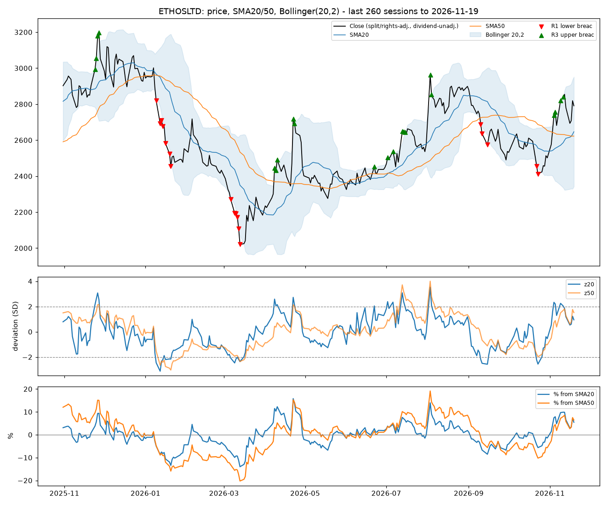
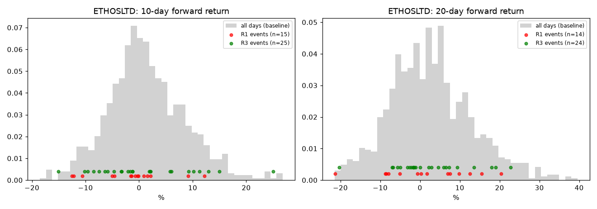
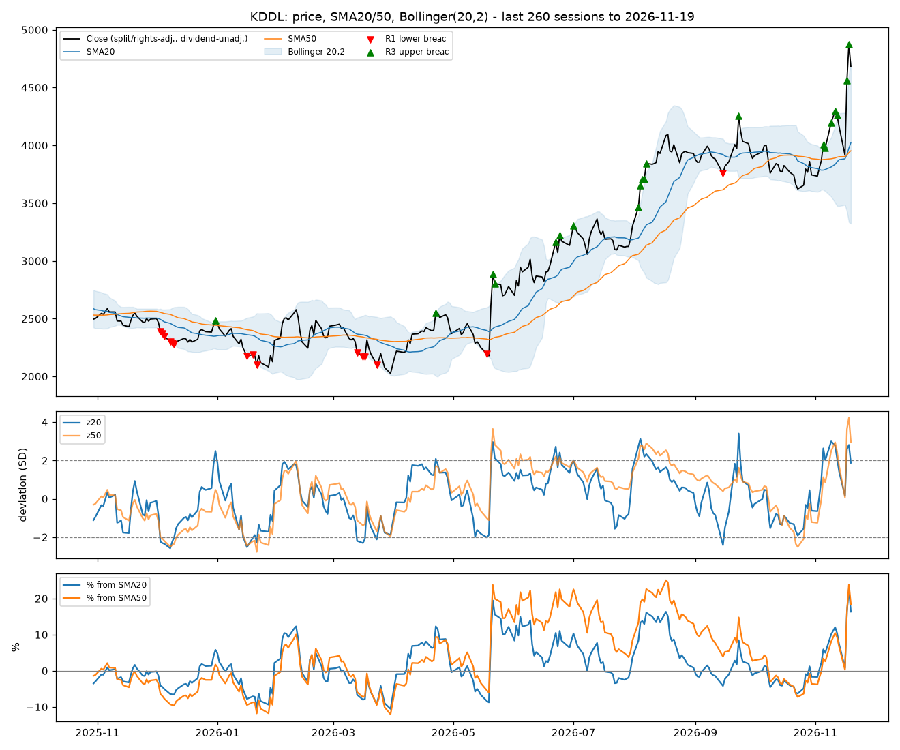
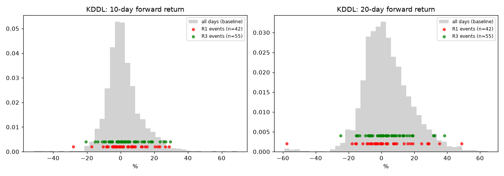

# Ethos Ltd (ETHOSLTD) and KDDL Ltd (KDDL): band study, analysed separately

Research and indicator study only. Not investment advice; no trades placed. Data through the **NSE session of Thu 19 Nov 2026** (checked at 23:08 IST, after the close).

## 1. Data and method

| | Ethos Ltd | KDDL Ltd |
|---|---|---|
| Listing / ticker | NSE `ETHOSLTD` (Yahoo `ETHOSLTD.NS`, "Ethos Limited", INR) | NSE `KDDL` (Yahoo `KDDL.NS`, "KDDL Limited", INR) |
| Coverage | 30 May 2022 to 19 Nov 2026, 1,107 daily bars | 12 Apr 2016 to 19 Nov 2026, 2,619 daily bars |
| Gaps | none >5 calendar days; 1 bar with null close dropped (KDDL) | |
| Latest completed close | ₹2,790.90 (19 Nov) | ₹4,679.80 (19 Nov) |

- **Source:** Yahoo Finance chart API, daily OHLCV. This is a **single source**. I could not cross-check it against NSE bhavcopy (the NSE site blocks scripted access), so treat the data as unverified against the exchange. The latest quote and the 19 Nov bar agree (the final bar is the completed session, not an intraday print). Live prices were not used anywhere; every number is a daily close.
- **Corporate actions:** the feed lists no splits or bonuses for either stock. Trendlyne agrees for Ethos ([bonus](https://trendlyne.com/equity/Bonus/ETHOSLTD/877860/ethos-ltd-bonus/), [split](https://trendlyne.com/equity/Split/ETHOSLTD/877860/ethos-ltd-split/)). A third-party page ([Sharpely](https://sharpely.in/stocks/stock-detail/Ethos-Ltd./ETHOSLTD)) lists an Ethos rights issue (ex-date 12 Jun 2025, 4 new shares at ₹1,800 for every 43 held). The non-round early prices in the file show Yahoo's `close` is back-adjusted for splits and rights, but not for dividends. I used that one consistently for all indicators. I did not mix in the `adjclose` series; I only re-ran signal counts on it as a sensitivity check. Counts changed by one (209 vs 210 KDDL upper breaches). KDDL's dividends are under 0.4% each, so this is immaterial.
- **Large moves are real, not splice errors:** KDDL's ±18–20% days are circuit-limit days. Its -57% worst 20-day return is the Mar 2020 Covid crash.
- **Context (not verified):** KDDL rose 16.5% on 17 Nov on a volume of 906k shares against a typical 12–50k. Sources I found do not say why ([INDmoney](https://www.indmoney.com/stocks/kddl-ltd-share-price), [Univest](https://univest.in/blogs/why-kddl-ltd-share-price-rise-today-2026)); a Q2 earnings call was scheduled for that day. Check the NSE filings before reading anything into the bands.

### Definitions (all on the **daily close** series C, population SD, windows ending at day t)

- `SMA_n = mean(C[t-n+1..t])`, n = 20, 50, 200
- **Percentage deviation:** `pct_n = C / SMA_n − 1`. This is a plain distance and ignores how volatile the stock is.
- **Deviation in SDs:** `z_n = (C − SMA_n) / SD_n`, where `SD_n` is the standard deviation of the **price level** over the same n days (not of returns).
- **Bollinger Bands (20, 2):** `Upper/Lower = SMA20 ± 2·SD20`. `%B = (C − Lower)/(Upper − Lower)`, bandwidth `= (Upper − Lower)/SMA20`.
- **Link between the three:** a close outside the band is exactly `|z20| ≥ 2`. The bands are the SD measure drawn on the chart.
- **Periods:** I used 20 and 50 days because they are conventional, and added 200 for context. I did not tune them. The windows are not independent: z20 and z50 are both high when a move is recent.

## 2. The test

A small set of six rules was fixed in advance. Out-of-sample split dates were also set before looking at results (Ethos from 1 Jul 2024, KDDL from 1 Jan 2023).

| ID | Signal at the close of day t | Idea tested |
|---|---|---|
| R1 | `z20 ≤ −2` (close below lower band) | mean reversion |
| R2 | z20 was ≤ −2 yesterday and is > −2 today | re-entry confirmation |
| R3 | `z20 ≥ +2` (close above upper band) | continuation vs reversal |
| R4 | z20 was ≥ +2 yesterday and is < 2 today | upper re-entry |
| R5 | `z50 ≥ +2` | stretched above the 50-day mean |
| R6 | `z50 ≤ −2` | stretched below the 50-day mean |

- **Look-ahead:** every signal uses data up to and including day t. Forward returns run from the close of day t to the close h days later (h = 5, 10, 20).
- **Overlap:** a signal is only counted if at least 20 sessions have passed since the last counted one ("raw" counts in the file are the undeduplicated days).
- **Baseline:** the average h-day forward return over **all** days in the same period. "Excess" is the signal mean minus that baseline. This matters because both stocks rose strongly over the sample, so any long-side rule looks good unless compared against it.
- **Uncertainty:** 90% bootstrap interval of the mean over events. Events are few and clustered in regimes, so the interval is itself optimistic.
- **Downside:** worst single event return and the average worst close within h days ("MAE").
- Full tables, including 5/10/20-day horizons for all six rules, full / in-sample / out-of-sample: `results.txt`.

### Indicator study vs trade simulation

The tables above are an **indicator study**: no entry, exit, cost or tax. The separate trade simulation in `results.txt` is closer to executable. It enters at the **next session's open** after the signal, with 0.15% slippage each way, exits at the close of the 10th session, and deducts STT 0.1% on each side, stamp duty 0.015% on the buy, exchange charges, and the DP charge on the sell. Brokerage is assumed zero. Income tax is not deducted. Short-term gains on listed shares are taxed at 20%, which would cut any positive average by about a fifth; confirm with your adviser. The simulation is long-only, with one position at a time and equal sizing.

## 3. Ethos Ltd

**Current position (19 Nov 2026):** close ₹2,790.9; SMA20 ₹2,646.7; SMA50 ₹2,622.4; SMA200 ₹2,525.9. Price is 5.5% above SMA20, 6.4% above SMA50 and 10.5% above SMA200. z20 = +0.95, z50 = +1.52, %B = 0.74; the band is ₹2,342 to ₹2,952. Bandwidth is 23%, which is in the wider 15% of its history. The close was above the upper band 6 sessions ago (9 Nov, z20 = 2.25) and has since pulled back inside. Volume on 19 Nov was 151k against a 20-day average of about 35k.

**Historical evidence (non-overlapping events; excess is against the all-days baseline):**

- **Lower-band breach (R1):** 15 events. In the earlier period (7 events) the 20-day return averaged +8.1%, which looked like a clean mean-reversion result. In the out-of-sample period (7–8 events) it reversed: -4.9% over 20 days, hit rate 29%, worst -21.3%. The two halves disagree, so no stable edge.
- **Upper-band breach (R3):** 25 events. Mean 10-day return +0.85% overall versus a baseline of +1.4%. Out-of-sample -2.4% at 10 days (12 events, hit rate 33%). Neither continuation nor reversal is supported.
- **R5/R6 and the re-entry rules:** confidence intervals include zero nearly everywhere; the one apparently positive R6 20-day result (+6.0%, n = 8) comes from 3 early events and did not hold out-of-sample (+0.5%, median -4.6%).
- **Trade simulation (10-day hold, net of costs, before tax):** R1 averaged -2.3% per trade (hit rate 27%, n = 15); R3 averaged -0.4% (n = 24); R2 averaged -0.2% (n = 15). Nothing survives costs.

**Verdict for Ethos:** there is **not enough evidence for a reliable rule**. Sample sizes are 5–25 events per rule, results flip between periods, and the post-mid-2024 behaviour is distinctly weaker than before. Band positions are a description of the price here, not a predictor.

## 4. KDDL Ltd

**Current position (19 Nov 2026):** close ₹4,679.8; SMA20 ₹4,022.4; SMA50 ₹3,952.3; SMA200 ₹3,113.9. Price is 16.3% above SMA20, 18.4% above SMA50 and 50.3% above SMA200. z20 = +1.88 (inside the upper band of ₹4,722), z50 = **+2.97**, %B = 0.97. Bandwidth is 34.8%, in the wider 12% of its history, after the 17–18 Nov jump (+16.5%, then +6.9%, then -4.0% on 19 Nov). The upper band was breached on 18 Nov (z20 = 2.81).

**Historical evidence:**

- **Upper-band breach (R3):** 55 events over 10 years. Full-sample 10-day mean +3.4% vs +1.8% baseline (hit rate 62%). The edge sits in the first period (4.7% at 5 days, 33 events). In the out-of-sample period (2023 onward, 22 events) it vanished: 5-day -0.2%, 10-day +1.5% (median -0.1%), 20-day +1.2% vs baseline +3.6%. Upper breaches at KDDL showed some continuation up to 2022, not since.
- **Lower-band breach (R1) and re-entry (R2):** the opposite pattern. In-sample R1 was indistinguishable from baseline (20-day +2.3% vs +3.5%, worst -57.6% in the Covid crash). Out-of-sample R1 gave +4.5% at 10 days (18 events, hit rate 56%, worst -8.3%) and R2 gave +5.5% (72% hit rate, worst -11.6%). Both are only modestly better than a baseline of +1.9% for 10 days and the 90% interval of the 20-day figure includes zero.
- **z50 ≥ +2 (R5)** is the rule that is on **now**: 34 events full sample, 20-day mean +4.5% vs +3.5% baseline; out-of-sample 10 events, +7.1%. It is the best-looking result, but 10 events on one strongly trending stock is thin, and the 10-day interval includes zero.
- **Trade simulation (10-day hold, net of costs, before tax):** R1 +2.0% average (n = 42, hit rate 45%, worst -29%); R2 +0.7% (worst -55%); R3 +1.6%; out-of-sample R3 +0.7%. Positive in places but with fat left tails, and the full-sample figures are carried by a rising stock.

**Verdict for KDDL:** **weak, regime-dependent evidence only.** The direction of the effect changed between the earlier and later periods, the stock has risen about 24x since 2016 so every long-side baseline is flattering, and the out-of-sample event counts are 8–22. No rule is reliable enough to act on by itself.

## 5. Proposed research alerts (watch signals for review, not instructions)

Evaluate once per day after the close on daily data, so no intraday noise.

| | Ethos | KDDL |
|---|---|---|
| **A. Upper-band breach** | `z20 ≥ 2`. Confirmation: second close above upper band, or 20-day average volume ratio > 2. Invalidation: close below SMA20. **Met now: No** (z20 0.95) | `z20 ≥ 2`. Same confirmation and invalidation. **Met now: No** (z20 1.88, but it was met on 18 Nov) |
| **B. Lower-band breach** | `z20 ≤ −2`; confirmation: re-entry (`z20` back above -2); invalidation: close below lowest close of the breach. **Met now: No** (last met 18 sessions ago) | Same. **Met now: No** (last met 44 sessions ago) |
| **C. Stretch above SMA50** | `z50 ≥ 2`. **Met now: No** (1.52) | `z50 ≥ 2`. **Met now: Yes** (2.97) |

- **Re-arm:** after firing, a condition re-arms only after the metric has been back inside |z| < 1 for a session (hysteresis), and at least 20 sessions have passed.
- **Duplicate suppression:** one message per condition per stock per episode; state is kept as the last fired date and the armed flag.
- **What an alert means:** the close was statistically unusual relative to its own recent range (roughly 1 day in 20 for a normal distribution; here it happens more because prices trend and volatility clusters). It says nothing about the direction of the next move.
- **What it does NOT establish:** that there is a profitable opportunity, that a reversion is due, or that a trend continues. The history above does not show a reliable edge for either stock. It also does not explain why the price moved (earnings, news); check the filings.
- **KDDL right now** is a case of unusual price positioning (z50 +2.97 after a 25% two-day move (16 Nov to 18 Nov close) on 5x normal volume), not evidence of an opportunity.

## 6. Can this environment alert you? What I checked

| Mechanism | Status |
|---|---|
| Scheduled tasks (desktop app) | Available. Checked: **none configured**. A task runs only while the Claude desktop app is open and the PC is awake, so it can miss a day. |
| Session cron (`CronCreate`) | Available but lives only while this session is open. Not suitable. |
| `PushNotification` | Available: desktop notification, and a phone push if Remote Control is connected. **Not tested** (it would send a real notification). |
| Gmail connector | Can create **drafts** only; no send tool is exposed, so it cannot email you. |
| Cloud routine / RemoteTrigger | Exists (runs without your PC) but needs a separate account setup and I have not enabled it. |

**Simplest workable setup (not activated):** a weekday scheduled task at 16:30 IST, after the NSE close (15:30). It downloads the two daily series (the same Yahoo calls), runs `analyze.py`'s indicator code, checks conditions A–C, compares them with a small state file (`alert_state.json`: armed flag and last-fired date per stock/condition), and calls `PushNotification` only on a new, armed trigger. Data freshness is "previous close, available about an hour after the market closes". Holidays are handled because no new bar means no new evaluation. Limits: Yahoo data can lag or fail (the task should report a failed fetch instead of staying silent), and nothing runs when the app is closed.

**Nothing is running. I have not created a task, sent a notification or linked any account.** I need your separate approval for each of these:
1. Create the weekday 16:30 IST scheduled task described above.
2. Send one test push notification now to confirm delivery.
3. (Optional) Set up a cloud routine instead, if you want it to run with the PC off.

## 7. Reproducing

In `research/bb/`: fetch `https://query1.finance.yahoo.com/v8/finance/chart/<SYMBOL>.NS?period1=1262304000&period2=1795200000&interval=1d&events=div|split` into `<SYMBOL>.raw.json`, then `python analyze.py`. It writes `results.txt`, `*_indicators.csv` (all indicators per day) and the PNGs. Random seed fixed (7). The bootstrap uses 2,000 resamples.

## 8. Limits

Single data source; the signal counts are small; both stocks were in strong uptrends over much of the sample; the out-of-sample split is one split, not walk-forward; costs and slippage are assumptions (0.15% slippage per side; exact charges vary by broker); I did not test volume, earnings dates or market-wide conditions. No result here should be read as a recommendation.
